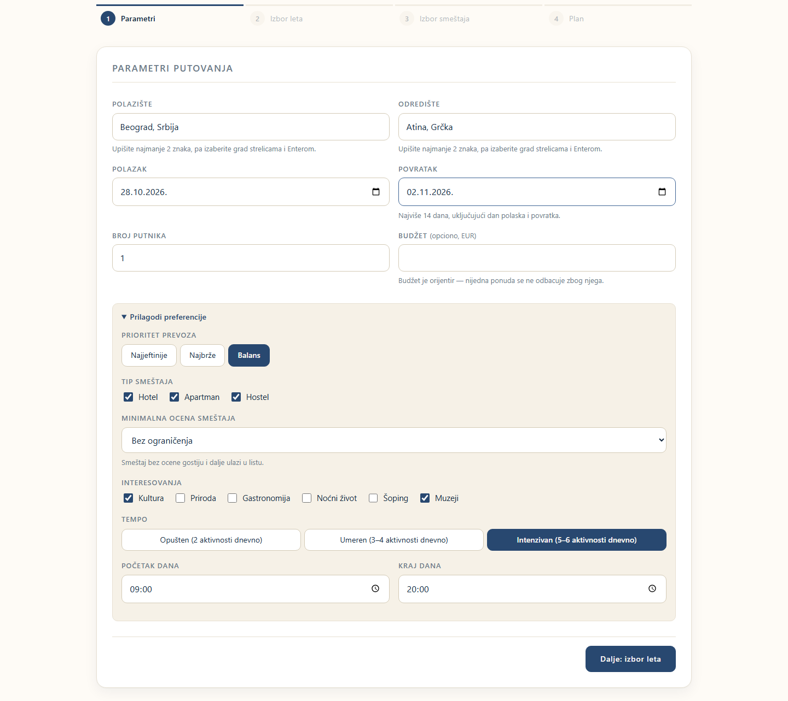
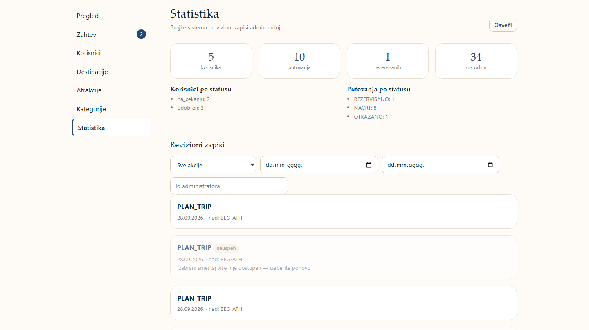

# Voyra — Microservice Travel Planner

Voyra builds a personalised, day-by-day travel plan (flights, accommodation and
attractions scheduled into time slots), lets the user edit and book it, and
notifies them by email. It is my bachelor's thesis project at the School of
Electrical Engineering, University of Belgrade (ETF).


## Highlights

- **9 Node.js microservices** behind an API Gateway, each with its own MongoDB database
- **Planning algorithm** in five phases: flight ranking → hotel ranking → attraction selection
  under time limits → k-means++ clustering into days → 2-opt route order and time slots
- **Real external APIs** through an adapter layer with caching and a mock fallback:
  Duffel (flights), LiteAPI (hotels), Geoapify and Wikipedia (attractions)
- **Security:** JWT with token revocation, role-based access, login lockout after repeated failures, audit log
- **Bilingual UI** (Serbian / English) in Angular 20
- **Tests:** 600+ unit tests, 190+ Angular (Karma) tests and 19 Selenium end-to-end scenarios
- **OpenAPI docs** served at `/docs` by every service

## Architecture

```
Angular (4200) ──► API Gateway (4000) ──► Orchestrator (4008)
                                              │
               ┌──────────────────────────────┼─────────────────────────┐
               ▼                              ▼                         ▼
        Planner (4004)                 Booking (4006)              Trip (4002)
               │                              │                         │
               ▼                              ▼                         ▼
       Integration (4003)            Notification (4007)          Admin (4005)
   Duffel · LiteAPI · Geoapify                                    User (4001)
```

| Service | Responsibility |
|---|---|
| API Gateway | Single entry point, JWT validation, token revocation, routing |
| Orchestrator | Unified `/v1` API used by the frontend; combines the other services |
| User | Registration, login, password change, roles |
| Trip | Saved trips, destinations, plan editing with optimistic locking |
| Integration | External API adapters, response cache with TTL, mock mode |
| Planner | Stateless planning algorithm |
| Booking | Flight and hotel booking, PDF confirmations |
| Notification | Email queue with retries |
| Admin | User management, featured destinations, statistics, audit log |

More detail: [architecture](documentation/ARCHITECTURE.md),
[algorithm](documentation/ALGORITHMS.md),
[database schema](documentation/DATABASE_SCHEMA.md),
[testing](documentation/TESTIRANJE.md).

## Screenshots

| Trip preferences | Generated day plan |
|---|---|
|  |  |
| **Booking** | **Admin statistics** |
|  |  |

A short demo video is in [`documentation/presentation`](documentation/presentation).

## Tech stack

**Backend:** Node.js, Express, MongoDB, Mongoose, JWT, Swagger/OpenAPI
**Frontend:** Angular 20, TypeScript, RxJS
**Testing:** Node test runner, Mocha, Karma/Jasmine, Selenium WebDriver
**Tooling:** Docker Compose (MongoDB)

## Running locally

Requires Node.js 18+ and MongoDB 6+ (or `docker-compose up -d` in `voyra/`).
Everything works without external API keys — the integration layer falls back
to mock data.

```bash
cd voyra
npm run install-all
for d in backend_Node/*-service backend_Node/api-gateway; do cp "$d/.env.example" "$d/.env"; done
(cd backend_Node/trip-service && npm run import:gradovi && npm run seed:kategorije && npm run seed:destinacije)
(cd backend_Node/user-service && npm run seed:demo)
npm run dev        # all 9 services + Angular on http://localhost:4200
npm run test:sve   # full test suite
```

Demo accounts and the full setup guide are in [`voyra/README.md`](voyra/README.md) (Serbian).

## Repository layout

```
voyra/            application source (backend_Node/, frontend/, e2e/)
documentation/    architecture, algorithm, database and testing docs, presentation
```
