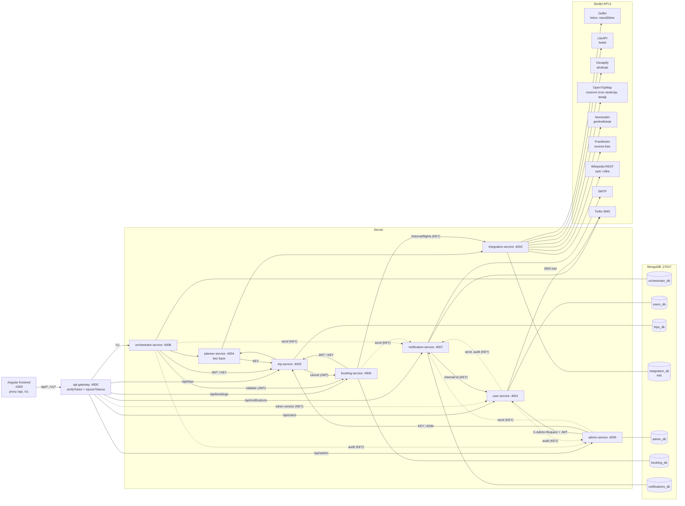
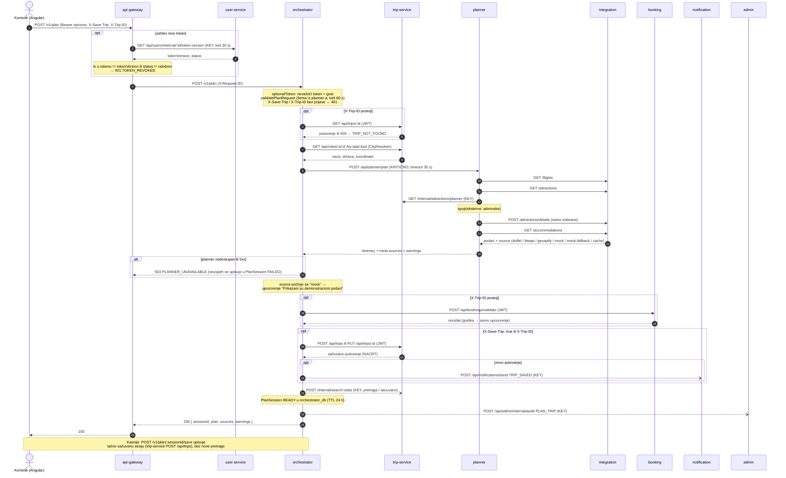
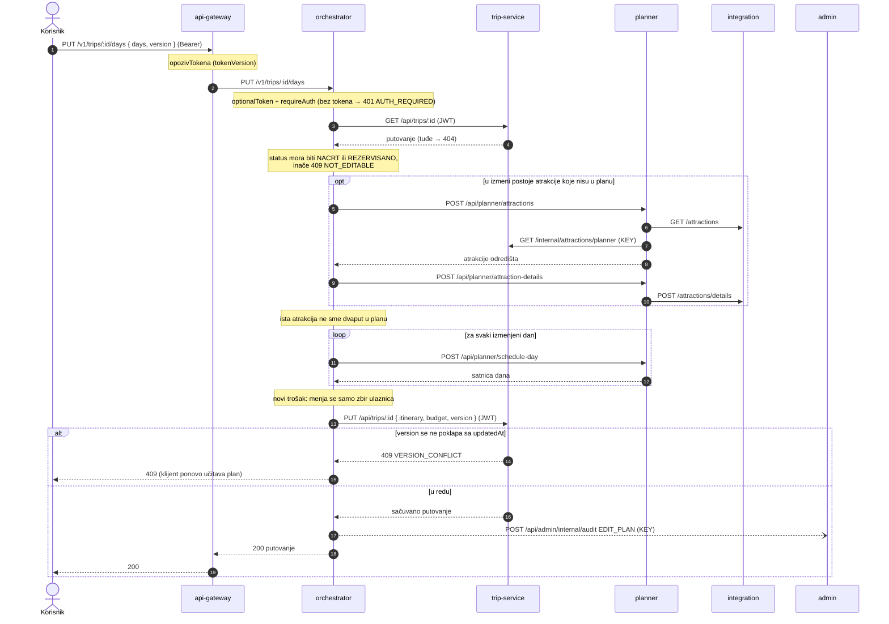
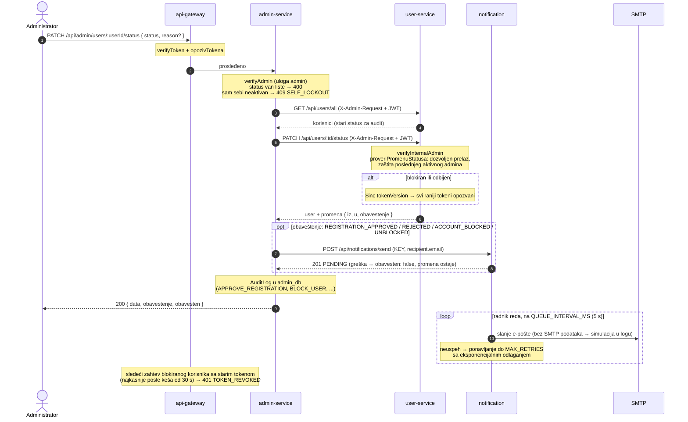

# ARCHITECTURE.md – Arhitektura sistema Voyra

Dokument opisuje arhitekturu **onako kako je implementirana** u
`voyra/backend_Node` (devet servisa i zajednički modul `shared`). Svaka
tvrdnja navodi fajl u kome se može proveriti. Putanje su relativne u
odnosu na `voyra/backend_Node/`, osim ako nije drugačije navedeno.
Vrednosti ključeva i tajni se ne navode – samo nazivi promenljivih
okruženja iz `<servis>/.env.example`.

Sadržaj:

1. Pregled servisa
2. Dijagram komponenti
3. Tokovi (sequence dijagrami)
4. Bezbednost
5. Adapteri, keš, mock/demo režim i polje `source`
6. Odstupanja od specifikacije §7

---

## 1. Pregled servisa

Svi servisi su Node.js + Express aplikacije. Pokreću se zajedno skriptom
`npm run start-all` (`voyra/package.json`, `concurrently`), a jedina
kontejnerizovana komponenta je MongoDB (`voyra/docker-compose.yml`,
servis `mongodb`, port 27017). Angular frontend (`voyra/frontend`) sve
zahteve šalje na gateway: `frontend/proxy.conf.json` prosleđuje `/api` i
`/v1` na `http://localhost:4000`.

Svaki servis izlaže `GET /health` i OpenAPI dokumentaciju na `/docs`
(`shared/docs.js`, isključuje se sa `DOCS_ENABLED=false`).

### 1.1 Tabela servisa

Port je podrazumevana vrednost iz `src/index.js` (poklapa se sa
`.env.example`). Baza je podrazumevani URI iz `src/config/database.js`.

| Servis | Port (promenljiva) | Baza | Odgovornost |
|---|---|---|---|
| api-gateway | 4000 (`GATEWAY_PORT`) | – | Jedina ulazna tačka; provera JWT-a na `/api/*` rutama; opoziv tokena (`tokenVersion`) za sve zahteve sa tokenom; prosleđivanje ka servisima (`src/routes/*.js`, `src/middleware/opozivTokena.js`) |
| user-service | 4001 (`USER_SERVICE_PORT`) | `users_db` | Registracija, prijava, izdavanje JWT-a, profil, promena lozinke, potvrda telefona SMS kodom, promena statusa i uloge naloga (na zahtev admin-service-a), ograničenje pokušaja prijave |
| trip-service | 4002 (`TRIP_SERVICE_PORT`) | `trips_db` | Putovanja i njihov status, gradovi i aerodromi (`/api/cities`), sadržaj koji uređuje administrator (kategorije interesovanja, atrakcije, istaknute destinacije), statistika pretraga; pozadinski posao `ZAVRSENO` (`src/services/ZavrsenaPutovanja.js`) |
| integration-service | 4003 (`INTEGRATION_SERVICE_PORT`) | `integration_db` | Adapteri ka spoljnim API-jima, keš sa TTL indeksima, mock i demo podaci, kreiranje i otkazivanje Duffel narudžbine |
| planner-service | 4004 (`PLANNER_SERVICE_PORT`) | – (bez stanja) | Algoritam planiranja (faze: letovi, atrakcije, smeštaj, raspodela po danima, redosled), spajanje spoljnih i administratorskih atrakcija, šema preferencija, raspored/optimizacija jednog dana |
| admin-service | 4005 (`ADMIN_SERVICE_PORT`) | `admin_db` | Administratorske operacije nad korisnicima, statistika, revizioni log (`AuditLog`), uređivanje sadržaja (prosleđuje trip-service-u), obaveštenje o odluci |
| booking-service | 4006 (`BOOKING_SERVICE_PORT`) | `booking_db` | Provera ponude, rezervacija leta, otkazivanje, PDF potvrda (`pdfkit`, `src/services/ConfirmationService.js`) |
| notification-service | 4007 (`NOTIFICATION_SERVICE_PORT`) | `notifications_db` | Red notifikacija u MongoDB-u, slanje e-pošte (Nodemailer/SMTP) i SMS-a (Twilio), šabloni, ponavljanje sa odlaganjem |
| orchestrator-service | 4008 (`ORCHESTRATOR_PORT`) | `orchestrator_db` | Jedinstveni API `/v1`: koraci čarobnjaka, planiranje, sesije plana (`PlanSession`), izmena plana, promena leta, destinacije, gradovi, `health` i statistika |

Napomena o `.env.example`: booking-service, admin-service, user-service i
orchestrator-service navode i promenljive `MONGODB_USERS_DB`,
`MONGODB_TRIPS_DB`, `MONGODB_ADMIN_DB`, `MONGODB_NOTIF_DB`, ali ih kod
ne čita (pretraga po `*/src` ne nalazi upotrebu). Svaki servis se
povezuje isključivo na svoju bazu – *database-per-service*. Podaci drugog
servisa se dobijaju samo REST pozivom.

### 1.2 Javne rute (kroz gateway)

Gateway izlaže samo navedene putanje; nova interna ruta ne postaje javna
slučajno, jer su putanje u gateway-u nabrojane pojedinačno
(`api-gateway/src/routes/admin.js`, funkcija `prosledi`).

| Prefiks na gateway-u | Ciljni servis | Rute (izvor: `api-gateway/src/routes/*.js`) | Zaštita na gateway-u |
|---|---|---|---|
| `/api/users` | user-service `/api/users` | `POST /register`, `POST /login` (javno); `GET /profile`, `GET /me`, `PUT /me`, `PUT /me/password`, `POST /me/phone/verify`, `POST /me/phone/resend`, `PATCH /me/sms-preference` | `verifyToken` osim register/login |
| `/api/trips` | trip-service `/api/trips` | `POST /plan` (javno, stari tok); `POST /`, `GET /`, `GET /:id`, `PUT /:id`, `PATCH /:id/cancel`, `DELETE /:id` | `verifyToken` osim `/plan` |
| `/api/bookings` | booking-service `/api/bookings` | `POST /validate`, `POST /`, `GET /`, `GET /:id`, `PATCH /:id/cancel`, `GET /:id/confirmation` (PDF kao binarni tok) | `verifyToken` |
| `/api/notifications` | notification-service `/api/notifications` | `GET /stats`, `GET /`, `GET /:id`, `POST /:id/retry`, `PATCH /:id/cancel` (ruta `/send` nije izložena) | `verifyToken` |
| `/api/admin` | admin-service `/api/admin` | `GET /users`, `PATCH /users/:userId/status`, `PATCH /users/:userId/role`, `DELETE /users/:userId`, `GET /stats`, `GET /logs`, `GET /logs/statistics`, CRUD `/categories`, `/attractions`, `/destinations` (+ `PATCH /destinations/order`) | `verifyToken`; uloga `admin` se proverava u admin-service-u (`src/middleware/auth.js`, `verifyAdmin`) |
| `/api/admin/notifications` | notification-service `/api/admin/notifications` | `GET` | `verifyToken`; admin se proverava u notification-service-u |
| `/v1` | orchestrator-service `/v1` | `GET /preferences/schema`, `GET /flights`, `GET /accommodations`, `GET /attractions`, `POST /plan`, `POST /plan/:sessionId/save`, `GET /plan/:sessionId`, `GET /trips/:id`, `POST /trips/:id/days/preview`, `PUT /trips/:id/days`, `POST /trips/:id/days/:day/optimize`, `POST /trips/:id/regenerate`, `POST /trips/:id/flight/refresh`, `PUT /trips/:id/flight`, `GET /destinations/featured`, `GET /destinations/popular`, `GET /cities`, `GET /cities/by-iata/:kod`, `GET /cities/:id`, `GET /health`, `GET /stats` | JWT opcion; potpis proverava orchestrator (`src/middleware/optionalToken.js`: `requireAuth` na `/trips/*`, `requireAdmin` na `/stats`) |

Gateway na `/v1` prosleđuje zaglavlja `Authorization`, `X-Request-ID`
(generiše ga ako ne postoji), `X-Save-Trip`, `X-Trip-ID` i
`X-Session-Id`, sa timeout-om `V1_TIMEOUT_MS` (podrazumevano 45 s, veće
od planner timeout-a od 35 s) – `api-gateway/src/routes/v1.js`.

**Nisu dostupni kroz gateway**: planner-service i integration-service u
celini, sve `/internal/*` rute, `/api/users/internal/*`,
`/api/users/all` i `/api/users/:id/status|role`, `/api/trips/all`,
`/api/admin/internal/audit`, `/api/notifications/send`, `/api/cities`
trip-service-a (do gradova se stiže samo preko `/v1/cities`).

### 1.3 Interne veze

Oznake u koloni „Zaštita":
**KEY** = zaglavlje `X-Internal-Key` sa vrednošću `INTERNAL_API_KEY`;
**JWT** = prosleđen korisnički `Authorization: Bearer`;
**ADM** = `X-Admin-Request: true` + admin JWT (`verifyInternalAdmin`);
**–** = bez provere (servis se oslanja na to da nije izložen van backenda).

| Pozivalac | Cilj | Ruta | Zaštita | Izvor u kodu |
|---|---|---|---|---|
| api-gateway | user-service | `GET /api/users/internal/:id/token-version` | KEY | `api-gateway/src/middleware/opozivTokena.js` |
| orchestrator | planner | `/api/planner/preferences/schema`, `/flights`, `/accommodations`, `/attractions`, `/plan`, `/attraction-details`, `/trip-days`, `/schedule-day`, `/optimize-day`, `/replan` | – | `orchestrator-service/src/services/clients/PlannerClient.js` |
| orchestrator | trip-service | `GET/POST/PUT /api/trips[/:id]`, `GET /api/cities…` | JWT (putovanja), – (gradovi) | `…/clients/TripClient.js` |
| orchestrator | trip-service | `GET /internal/destinations`, `GET /internal/destinations/popular`, `POST /internal/search-stats` | KEY | `…/clients/TripClient.js` |
| orchestrator | booking-service | `POST /api/bookings/validate` (samo kada postoji `tripId`) | JWT | `…/clients/BookingClient.js` |
| orchestrator | notification-service | `POST /api/notifications/send` (`TRIP_SAVED`) | KEY | `…/clients/NotificationClient.js` |
| orchestrator | admin-service | `POST /api/admin/internal/audit` | KEY | `…/clients/AdminClient.js` |
| orchestrator | svi servisi | `GET /health` (periodično, `HEALTH_CHECK_INTERVAL_MS`) | – | `…/services/ServiceHealthMonitor.js` |
| planner | integration-service | `GET /flights`, `GET /accommodations`, `GET /attractions`, `POST /attractions/details` | – | `planner-service/src/services/FlightService.js`, `AccommodationService.js`, `AttractionService.js` |
| planner | trip-service | `GET /internal/categories`, `GET /internal/attractions/planner` | KEY | `planner-service/src/services/KategorijeService.js`, `AdminAtrakcijeService.js` |
| trip-service | planner | `POST /api/planner/plan` (stari tok `/api/trips/plan`) | – | `trip-service/src/services/TripService.js` (`planTrip`) |
| trip-service | booking-service | `PATCH /api/bookings/:id/cancel` | JWT | `TripService.js` (`otkaziPutovanje`) |
| booking-service | trip-service | `GET /api/trips/:id` | JWT | `booking-service/src/services/clients/TripClient.js` |
| booking-service | trip-service | `PATCH /internal/trips/:id/status` | KEY | isto |
| booking-service | integration-service | `GET /internal/flights/offers/:offerId`, `POST /internal/flights/orders`, `POST /internal/flights/orders/:orderId/cancel` | KEY | `booking-service/src/services/clients/IntegrationClient.js` |
| booking-service | notification-service | `POST /api/notifications/send` | KEY | `booking-service/src/services/clients/NotificationClient.js` |
| admin-service | user-service | `GET /api/users/all`, `PATCH /api/users/:id/status`, `PATCH /api/users/:id/role`, `DELETE /api/users/:id` | ADM | `admin-service/src/services/AdminService.js` |
| admin-service | trip-service | `GET /api/trips/all` | ADM | isto (`getSystemStats`) |
| admin-service | trip-service | `/internal/categories`, `/internal/attractions`, `/internal/destinations` (CRUD) | KEY | `admin-service/src/services/TripContentService.js` |
| admin-service | integration-service | `GET /health` | – | `AdminService.js` |
| admin-service | notification-service | `POST /api/notifications/send` (odluka o nalogu) | KEY | `admin-service/src/services/clients/NotificationClient.js` |
| user-service | notification-service | `POST /api/notifications/send` | KEY | `user-service/src/services/NotificationClient.js` |
| user-service | admin-service | `POST /api/admin/internal/audit` | KEY | `user-service/src/services/AuditClient.js` |
| notification-service | user-service | `GET /api/users/internal/:id` (e-pošta, telefon, SMS saglasnost) | KEY | `notification-service/src/services/NotificationService.js` (`_razresiPrimaoca`) |

---

## 2. Dijagram komponenti



Napomene uz dijagram:

- Isprekidane strelice su pozivi „pošalji i zaboravi": neuspeh ne obara
  akciju (npr. `this.admin.log(...).catch(() => {})` u
  `orchestrator-service/src/services/OrchestrationService.js`).
- OpenTripMap je *rezervni* izvor atrakcija: koristi se samo kada
  Geoapify ključ nije ispravno podešen
  (`integration-service/src/routes/integration.js`,
  `attractionsAdapter = geoapifyKonfigurisan() ? geoapifyAdapter : openTripMapAdapter`).
  Osim toga, `AttractionDetailsAdapter` koristi OpenTripMap `/places/xid`
  za opis i sliku atrakcija koje odatle potiču.
- Booking.com se ne poziva kao API: smeštaj se ne rezerviše, nego se
  gradi link ka javnoj pretrazi (`integration-service/src/utils/bookingLink.js`).
- Twilio se poziva i iz user-service-a (slanje SMS koda,
  `user-service/src/services/SMSClient.js`) i iz notification-service-a.

---

## 3. Tokovi

### 3.1 Planiranje putovanja (`POST /v1/plan`)

Izvor: `orchestrator-service/src/routes/v1.js` (ruta `/plan`),
`OrchestrationService.plan()`, `planner-service/src/services/TravelPlanner.js`.

Pre ovog koraka čarobnjak (frontend) redom poziva
`GET /v1/preferences/schema`, `GET /v1/flights` i
`GET /v1/accommodations`; svi idu orchestrator → planner → integration.



Kritični su samo planner i integration (`orchestrator-service/src/config/serviceRegistry.js`,
`critical: true`). Pad booking-, trip-, notification- ili admin-service-a
daje upozorenje u odgovoru, a plan se vraća sa statusom 200.

### 3.2 Izmena plana (`PUT /v1/trips/:id/days`)

Izvor: `orchestrator-service/src/services/PlanEditService.js`
(`sacuvaj`, `preracunaj`, `razresiAtrakcije`), `routes/v1.js`.
Pregled bez čuvanja je `POST /v1/trips/:id/days/preview`, optimizacija
jednog dana `POST /v1/trips/:id/days/:day/optimize`, a ponovno
generisanje `POST /v1/trips/:id/regenerate` (planner `/replan`, letovi i
smeštaj se ne pretražuju ponovo).



### 3.3 Rezervacija leta i otkazivanje

Izvor: `booking-service/src/services/BookingService.js` (`validate`,
`create`, `cancel`), `trip-service/src/services/TripService.js`
(`otkaziPutovanje`), `integration-service/src/adapters/DuffelFlightAdapter.js`
(`kreirajNarudzbinu` – plaćanje tipom `balance` iz Duffel test naloga,
bez kartice). Frontend: `frontend/src/app/core/services/booking-api.service.ts`
i `trip-api.service.ts`.

```mermaid
sequenceDiagram
    autonumber
    actor K as Korisnik
    participant GW as api-gateway
    participant BK as booking-service
    participant TR as trip-service
    participant IN as integration
    participant DF as Duffel
    participant NT as notification

    K->>GW: POST /api/bookings/validate { tripId, offerId? }
    GW->>BK: verifyToken + opozivTokena, prosleđeno
    BK->>TR: GET /api/trips/:id (JWT)
    Note over BK: REZERVISANO → 409 ALREADY_BOOKED<br/>OTKAZANO/ZAVRSENO → INVALID_STATE
    BK->>IN: GET /internal/flights/offers/:offerId (KEY)
    IN->>DF: sveža ponuda (bez ključa → mock)
    IN-->>BK: ponuda, cena (istekla → OFFER_EXPIRED)
    BK-->>K: valid, priceChanged, oldPrice, newPrice

    K->>GW: POST /api/bookings { tripId, passengers[], acceptedPrice }
    GW->>BK: prosleđeno
    BK->>TR: GET /api/trips/:id (JWT)
    Note over BK: provera putnika; postoji PENDING/CONFIRMED<br/>→ ALREADY_BOOKED / BOOKING_IN_PROGRESS
    BK->>IN: GET /internal/flights/offers/:offerId (KEY)
    Note over BK: acceptedPrice != nova cena → 409 PRICE_CHANGED
    Note over BK: Booking PENDING u booking_db
    BK->>IN: POST /internal/flights/orders (KEY)
    IN->>DF: narudžbina (payments: balance)
    alt neuspeh
        IN-->>BK: greška
        Note over BK: Booking FAILED, greška klijentu
    else uspeh
        IN-->>BK: orderId, bookingReference (PNR)
        Note over BK: Booking CONFIRMED
        BK->>TR: PATCH /internal/trips/:id/status REZERVISANO (KEY)
        Note over BK: PDF potvrda (pdfkit)
        BK->>NT: POST /api/notifications/send BOOKING_CONFIRMED (KEY)
        BK-->>K: 201 rezervacija (+ upozorenje ako status putovanja nije ažuriran)
    end

    K->>GW: PATCH /api/trips/:id/cancel
    GW->>TR: prosleđeno (verifyToken)
    Note over TR: ZAVRSENO → 409 INVALID_TRANSITION
    opt putovanje ima bookingInfo.bookingId
        TR->>BK: PATCH /api/bookings/:id/cancel (JWT)
        BK->>IN: POST /internal/flights/orders/:orderId/cancel (KEY)
        IN->>DF: otkazivanje narudžbine
        IN-->>BK: potvrda (nepotvrđeno → CANCEL_NOT_CONFIRMED)
        Note over BK: Booking CANCELLED
        BK->>TR: PATCH /internal/trips/:id/status OTKAZANO (KEY)
        BK->>NT: POST /api/notifications/send BOOKING_CANCELLED (KEY)
        BK-->>TR: 200 (greška → 502 FLIGHT_CANCEL_FAILED, putovanje ostaje rezervisano)
    end
    Note over TR: ako status još nije OTKAZANO, postavlja ga sam
    TR-->>K: 200 putovanje OTKAZANO
```

Pre rezervacije frontend može da osveži ili zameni let preko
`POST /v1/trips/:id/flight/refresh` i `PUT /v1/trips/:id/flight`
(`orchestrator-service/src/services/FlightChangeService.js`). Smeštaj se
ne rezerviše u aplikaciji – korisnik dobija Booking.com link.

### 3.4 Odluka administratora (odobravanje registracije ili blokada)

Izvor: `admin-service/src/routes/users.js` (`PATCH /:userId/status`),
`admin-service/src/services/AdminService.js`,
`user-service/src/routes/admin.js`, `user-service/src/config/statusi.js`,
`notification-service/src/services/NotificationService.js` i
`NotificationQueue.js`.

Dozvoljeni prelazi (`statusi.js`, `PRELAZI`): `na_cekanju → odobren | odbijen`,
`odobren → blokiran`, `blokiran → odobren`, `odbijen → odobren`.



---

## 4. Bezbednost

### 4.1 JWT

- Token izdaje isključivo user-service (`user-service/src/utils/jwt.js`,
  `generateToken`): payload `{ id, korisnickoIme, email, uloga, tv }`,
  trajanje `JWT_EXPIRY` (podrazumevano `24h`), potpis `JWT_SECRET`.
- Lozinke se heširaju bcrypt-om (`user-service/src/models/User.js`,
  `BCRYPT_ROUNDS`, podrazumevano 10).
- Prijava je moguća samo za status `odobren`; ostali statusi dobijaju
  403 sa porukom statusa (`user-service/src/routes/auth.js`).
- Gateway na `/api/*` rutama proverava potpis (`api-gateway/src/middleware/auth.js`,
  `verifyToken`). Na `/v1` gateway ne odbija zahtev zbog tokena, jer je
  prijava opciona (gost sme da planira); potpis proverava orchestrator
  lokalno, bez poziva user-service-a (`orchestrator-service/src/middleware/optionalToken.js`).
- Servisi iza gateway-a ponovo proveravaju potpis istim `JWT_SECRET`-om
  (npr. `admin-service/src/middleware/auth.js`, `booking-service/src/middleware/auth.js`),
  a uloga `admin` se proverava u servisu koji izvršava akciju.

### 4.2 Opoziv tokena (`tokenVersion`)

- Korisnik u `users_db` ima polje `tokenVersion`; token nosi claim `tv`.
- Verzija se uvećava pri: promeni lozinke (`user-service/src/routes/users.js`,
  odgovor nosi nov token), blokiranju ili odbijanju naloga
  (`statusi.js`, `ponistavaTokene`), promeni uloge (`routes/admin.js`).
- Gateway middleware `opozivTokena` stoji pre svih ruta (osim `/health`
  i `/`) i za svaki zahtev sa ispravno potpisanim tokenom pita
  `GET /api/users/internal/:id/token-version` (KEY). Odbija sa
  **401 TOKEN_REVOKED** ako nalog ne postoji, ako se `tv` razlikuje od
  `tokenVersion` ili ako status nije `odobren`.
- Odgovor se kešira u memoriji gateway-a `TOKEN_VERSION_CACHE_MS`
  (podrazumevano 30 s, `0` isključuje keš; najviše 5000 zapisa). Token
  noviji od zapamćene verzije izaziva trenutno osvežavanje.
- Kada user-service ne odgovara, zahtev **sa tokenom** se odbija sa
  **503 AUTH_UNAVAILABLE** (ne propušta se); zahtevi bez tokena prolaze.
- Ograničenje: opoziv proverava samo gateway. Servisi iza njega
  proveravaju samo potpis, pa je zaštita potpuna samo dok su servisi
  dostupni isključivo kroz gateway.

### 4.3 Interni pozivi

- `X-Internal-Key` = `INTERNAL_API_KEY`, isti na svim servisima. Proveru
  rade: `integration-service/src/middleware/internalKey.js` (503
  `INTERNAL_KEY_MISSING` ako ključ nije podešen, 401 ako se ne poklapa),
  `trip-service/src/middleware/internalKey.js` (isto ponašanje),
  `user-service/src/middleware/verifyInternalKey.js`,
  `admin-service/src/routes/internal.js`, a
  `notification-service/src/middleware/auth.js` (`verifyInternal`)
  prihvata ili ključ ili važeći JWT.
- Orchestrator odbija pokretanje bez `JWT_SECRET`, `INTERNAL_API_KEY` i
  URL-ova svih servisa (`orchestrator-service/src/config/serviceRegistry.js`,
  `proveriKonfiguraciju`).
- Admin → user/trip: zaglavlje `X-Admin-Request: true` **i** admin JWT
  (`user-service/src/middleware/internalAdmin.js`,
  `trip-service/src/middleware/internalAdmin.js`); samo zaglavlje nije
  dovoljno.
- Rute bez provere (planner u celini, javne rute integration-service-a,
  `/api/cities`, `/cache/clear`) nisu izložene kroz gateway; zaštićene
  su samo time što nisu dostupne spolja.

### 4.4 Ograničenja pokušaja

- **Prijava**: `user-service/src/services/PokusajiPrijave.js` i model
  `LoginAttempt` (kolekcija u `users_db`). Ključ je
  `korisnickoIme|ip`; posle `LOGIN_MAX_ATTEMPTS` (podrazumevano 5)
  promašaja u prozoru `LOGIN_WINDOW_MINUTES` (15 min, meri se od prvog
  pokušaja) odgovor je **429 RATE_LIMIT** sa `retryAfter`. Uspešna
  prijava briše brojač; TTL indeks na `prviPokusaj` briše stare zapise.
- **Promena lozinke**: isti mehanizam, ključ `korisnikId|password`.
- **SMS kod**: `user-service/src/services/PhoneVerificationService.js`,
  `SMS_MAX_RETRIES` (3) pokušaja, zatim zaključavanje na
  `RATE_LIMIT_WINDOW_MINUTES` (5 min) sa 429.
- Opšti *rate limiter* po IP adresi (npr. `express-rate-limit`) ne
  postoji ni u jednom servisu.

### 4.5 Ostalo

- CORS je otvoren (`app.use(cors())`) u svim servisima.
- Gateway prosleđuje celo telo greške servisa i zaglavlje `Retry-After`
  (`api-gateway/src/utils/proxy.js`); nedostupan servis daje 503
  `SERVICE_UNAVAILABLE`.
- Tuđe putovanje trip-service vraća kao 404 (ne otkriva postojanje);
  tuđa rezervacija u booking-service-u daje 403.
- Ključ spoljnog API-ja za letove drži samo integration-service;
  booking-service rezerviše isključivo preko njegovih `/internal/*` ruta.

---

## 5. Adapteri, keš, mock/demo režim i polje `source`

### 5.1 Adapteri (`integration-service/src/adapters`)

Svi adapteri nasleđuju `BaseAdapter`, koji implementira keš kao šablon
metodu `withCache(queryKey, dohvati, { jeUpotrebljiv, preskociKes })`:
keš → (promašaj) → spoljni poziv → upis u keš. Greška u kešu ne obara
zahtev. `jeUpotrebljiv` odbacuje keširan zapis sa ponudama koje uskoro
ističu (`utils/ponude.js`, `OFFER_MIN_VALID_SECONDS`, 120 s), a
`preskociKes` se koristi za svežu ponudu pred rezervaciju.

| Adapter | Spoljni izvor | Uloga | Rezerva |
|---|---|---|---|
| `DuffelFlightAdapter` | Duffel | Pretraga letova, ponuda po `offerId`, kreiranje i otkazivanje narudžbine | `FlightAdapter` (mock) |
| `LiteApiHotelAdapter` | LiteAPI | Pretraga hotela; centar grada iz Nominatim-a | `AccommodationAdapter` (mock) |
| `GeoapifyPlacesAdapter` | Geoapify Places | Atrakcije (primarni izvor); brojač dnevnih kredita `utils/geoapifyKrediti.js` (`GEOAPIFY_DAILY_CREDITS`, upozorenje na 80 %) | mock (`AttractionsAdapter`) |
| `OpenTripMapAdapter` | OpenTripMap | Atrakcije kada Geoapify ključ nije ispravan | mock |
| `AttractionDetailsAdapter` | OpenTripMap `/places/xid` + `WikipediaImageAdapter` | Opis i slika atrakcije, u grupama po 6 | atrakcija ostaje bez slike |
| `NominatimGeocodeAdapter` | Nominatim (OSM) | Koordinate grada | ugrađeni `POZNATI_CENTRI` (`mock-fallback`) |
| `FrankfurterExchangeAdapter` | Frankfurter (ECB) | Preračun cena u EUR za Duffel i LiteAPI | ugrađeni kursevi `UGRADJENI_KURSEVI` (`mock-fallback`) |

Spoljni izvor se smatra podešenim samo ako ključ nije prazan i nije
šablonska vrednost (`config/externalApis.js`, `PLACEHOLDERI`); Geoapify
ključ mora dodatno da ima oblik 32 heksadecimalna znaka.

### 5.2 Keš (TTL po vrsti podatka)

Izvor: `integration-service/src/models/CacheModels.js`. Brisanje radi
MongoDB TTL indeks na `createdAt`. Pri pokretanju
`config/ttlIndeksi.js` usklađuje postojeće TTL indekse sa kodom
(`collMod`), jer MongoDB sam ne menja postojeći indeks.

| Kolekcija (`integration_db`) | Promenljiva | Podrazumevano |
|---|---|---|
| `flights_cache` | `CACHE_TTL_FLIGHTS` | 900 s (15 min) |
| `accommodations_cache` | `CACHE_TTL_ACCOMMODATIONS` | 1800 s (30 min) |
| `attractions_cache` | `CACHE_TTL_ATTRACTIONS` | 604800 s (7 dana) |
| `exchange_rates_cache` | `CACHE_TTL_RATES` | 86400 s (24 h) |
| `geocode_cache` | `CACHE_TTL_GEOCODE` | 2592000 s (30 dana) |
| `attraction_details_cache` | `CACHE_TTL_ATTRACTION_DETAILS` | 2592000 s (30 dana) |

Ruta `POST /cache/clear` (bez zaštite, nije izložena kroz gateway) prazni
prvih pet kolekcija.

Ostali kratkotrajni podaci u sistemu:

| Šta | Gde | Trajanje |
|---|---|---|
| Verzija tokena | memorija gateway-a | `TOKEN_VERSION_CACHE_MS`, 30 s |
| Šema preferencija | memorija orchestrator-a (`PlannerClient`) | 60 s |
| Kategorije interesovanja | memorija planner-a (`KategorijeService`) | 60 s |
| Sesija plana `PlanSession` | `orchestrator_db`, TTL na `expiresAt` | `PLAN_SESSION_TTL_HOURS` 24 h; neuspele `FAILED_SESSION_TTL_DAYS` 7 dana |
| Pokušaji prijave `LoginAttempt` | `users_db` | `LOGIN_WINDOW_MINUTES`, 15 min |
| Revizioni log `AuditLog` | `admin_db` | `AUDIT_LOG_TTL`, 90 dana |
| Notifikacije i log slanja | `notifications_db`, TTL na `expiresAt` / `timestamp` | `TTL_SENT_DAYS`, `TTL_FAILED_DAYS`, `TTL_LOGS_DAYS` |
| Mock fajlovi | memorija integration-service-a (`utils/mockData.js`) | do restarta |

### 5.3 Mock i demo režim

- **Mock**: bez ključa (ili sa šablonskom vrednošću) adapter ne zove
  spoljni API, već čita `voyra/mock_data/flights.json`,
  `accommodations.json`, `attractions.json` (`utils/mockData.js`,
  `MOCK_DATA_PATH`). Mock ponuda leta važi `MOCK_OFFER_TTL_MINUTES`
  (20 min). Mock narudžbina je deterministička (`orderId`
  `ord_mock_…`, PNR iz `offerId`-ja).
- **Demo generator** (`utils/demoGenerator.js`): ručni mock pokriva
  samo rutu BEG → ATH i smeštaj u Atini. Za svaku drugu rutu i grad
  `FlightAdapter` i `AccommodationAdapter` prave determinističke ponude
  (seme iz rute i datuma): kompanija „Demo Air", smeštaj
  „Demo smestaj – {grad}". Atrakcije se ne izmišljaju.
- **Rezerva pri grešci**: ako spoljni API sa podešenim ključem ne
  odgovori ili vrati grešku, adapter prelazi na mock
  (`source: 'mock-fallback'`). Kod Geoapify-ja i greška 429 (iscrpljen
  dnevni limit) vodi na mock, ne na OpenTripMap.
- **Simulacija obaveštenja**: `EmailService` bez `SMTP_HOST`,
  `SMTP_USER`, `SMTP_PASS` i `SMSService` bez `TWILIO_*` promenljivih
  upisuju poruku u log i vraćaju `simulated: true`
  (`notification-service/src/services/EmailService.js`, `SMSService.js`).

### 5.4 Polje `source`

Svaki odgovor integration-service-a nosi poreklo podataka:

| Vrednost | Značenje | Primer izvora |
|---|---|---|
| `duffel`, `liteapi`, `geoapify`, `opentripmap`, `nominatim`, `frankfurter` | Sveži podaci iz spoljnog API-ja | odgovarajući adapter |
| `cache` | Podatak iz keš kolekcije | `BaseAdapter.withCache` (`cached: true`) |
| `mock` | Ključ nije podešen (ručni mock ili demo generator) | npr. `DuffelFlightAdapter`, `GeoapifyPlacesAdapter` |
| `mock-fallback` | Ključ postoji, ali je spoljni poziv pao | isto |

Planner prenosi izvore u `meta.sources` (`flights`, `accommodations`,
`attractions`; `TravelPlanner.js`), orchestrator ih stavlja u odgovor i u
`PlanSession.sources`, a kada izvor leta ili smeštaja počinje sa `mock`
dodaje upozorenje „Prikazani su demonstracioni podaci"
(`OrchestrationService.plan`).

---

## 6. Odstupanja od specifikacije §7

Specifikacija (`documentation/SPECIFIKACIJA.md`, §7) predviđa pet
backend servisa (gateway, user, trip, integration, planner) i tri baze.
Implementacija se od nje razlikuje na sledeći način:

| # | Specifikacija §7 | Implementacija | Obrazloženje |
|---|---|---|---|
| 1 | Pet servisa + frontend | Devet servisa: dodati admin-, booking-, notification- i orchestrator-service | Trip Service je u specifikaciji imao četiri nepovezane odgovornosti (putovanja, rezervacije, sadržaj, orkestracija). Izdvajanjem su rezervacije sa spoljnom narudžbinom, slanje poruka sa redom i ponavljanjem, i orkestracija sa delimičnim otkazima postali zasebne celine koje se mogu nezavisno menjati i testirati. |
| 2 | MongoDB sa bazama `users_db`, `trips_db`, `integration_db` | Sedam baza: dodate `admin_db`, `booking_db`, `notifications_db`, `orchestrator_db` | Posledica principa *database-per-service* iz same §7 za nove servise. |
| 3 | Trip Service radi orkestraciju; §7.1: `POST /trips/plan` | Orkestraciju radi orchestrator-service na `POST /v1/plan` (i koracima čarobnjaka `/v1/*`) | Planiranje sada obuhvata razrešavanje gradova, sesiju plana, validaciju, čuvanje, statistiku, obaveštenje i audit, uz jasnu podelu na kritične (planner, integration) i nekritične servise (`serviceRegistry.js`). Stari tok `POST /api/trips/plan` (gateway → trip → planner) postoji i dalje, ali ga frontend ne koristi. |
| 4 | §7.1 t.3: Trip Service preuzima atrakcije i spaja ih sa administratorskim | Spajanje radi planner (`SpajanjeAtrakcija.spoji`), koji administratorske atrakcije čita iz trip-service-a (`/internal/attractions/planner`, KEY) | Spajanje je deo ocenjivanja i izbora atrakcija u algoritmu; čuvanje administratorskih atrakcija ostaje u `trips_db`, u skladu sa §7. |
| 5 | §7.1 t.2: gateway validira JWT ako postoji | Na `/api/*` gateway proverava potpis; na `/v1` potpis proverava orchestrator (nevažeći token = gost). Gateway za svaki token dodatno proverava opoziv (`tokenVersion`) | Na `/v1` je prijava opciona. Opoziv je dodat da blokiran nalog i promenjena lozinka ne bi važili do isteka tokena (24 h). |
| 6 | §7.2: `POST /trips/{id}/booking`; Trip Service proverava i menja status u REZERVISANO | `POST /api/bookings/validate` i `POST /api/bookings` u booking-service-u; status menja booking-service preko `PATCH /internal/trips/:id/status` (KEY) | Rezervacija ima sopstveni životni ciklus (PENDING, CONFIRMED, FAILED, CANCELLED), proveru promene cene i PDF potvrdu; otkazivanje ide trip → booking → integration → Duffel. |
| 7 | User Service šalje elektronsku poštu | E-poštu i SMS šalje notification-service preko reda u MongoDB-u; user-service samo šalje SMS kod za potvrdu telefona | Slanje ne sme da obori akciju (odluka administratora, rezervacija); red omogućava ponavljanje i prikaz statusa. |
| 8 | Nisu predviđene interne rute | `/internal/*` rute zaštićene zaglavljem `X-Internal-Key`; admin pozivi traže `X-Admin-Request` + admin JWT | Pozivi servis-servis ne smeju biti dostupni klijentu, a gateway ih ne izlaže. |
| 9 | Integration Service – izvori nisu nabrojani u §7 | Geoapify je primarni izvor atrakcija, OpenTripMap rezervni (kada Geoapify ključ nije podešen); dodati Nominatim, Frankfurter i Wikipedia | Komentar u `integration-service/src/routes/integration.js`: OpenTripMap ključ nije mogao da se dobije. Nominatim, Frankfurter i Wikipedia daju koordinate, preračun u EUR i slike. |
| 10 | Tabela §7 ne navodi administratorski servis | Uređivanje sadržaja ide kroz admin-service, a podaci ostaju u trip-service-u | Administrator ima jednu ulaznu tačku (`/api/admin/*`) sa auditom, a vlasnik podataka ostaje trip-service. |

---

## Dodatak: zapažanja iz koda

- Orchestrator u koraku provere rezervacije šalje
  `{ tripId, flightOfferIds, propertyIds }`
  (`orchestrator-service/src/services/clients/BookingClient.js`), a
  booking-service iz tela čita samo `tripId` i `offerId`
  (`booking-service/src/routes/bookings.js`). Let se tada uzima iz
  sačuvanog plana, pa poziv radi, ali `flightOfferIds` i `propertyIds`
  se zanemaruju.
- `notification-service/src/services/clients/NotificationClient.js`
  se nigde ne učitava (nije korišćen).
- Promenljive `MONGODB_USERS_DB`, `MONGODB_TRIPS_DB`, `MONGODB_ADMIN_DB`
  i `MONGODB_NOTIF_DB` iz `.env.example` fajlova kod ne koristi.
